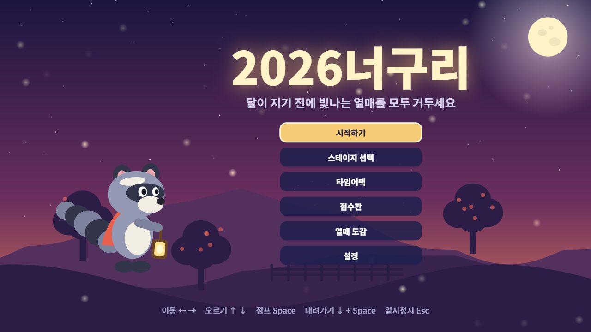
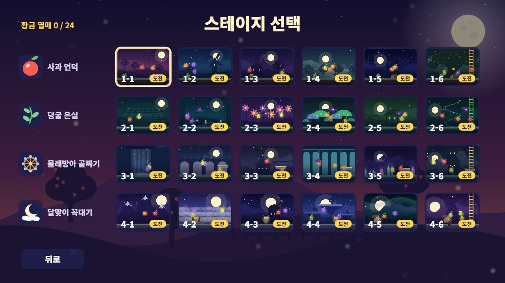
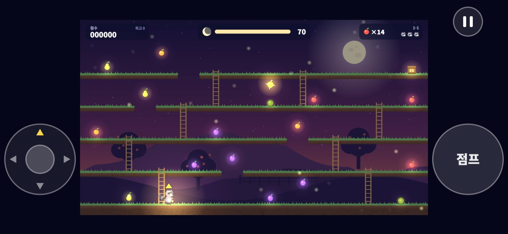
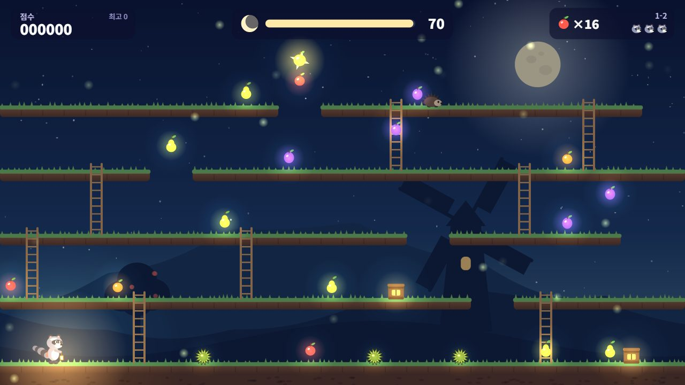
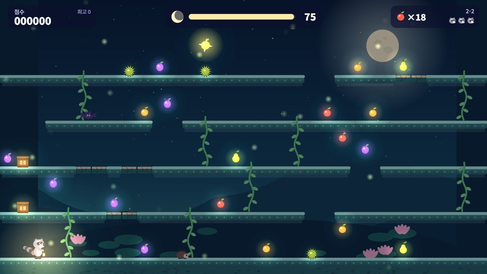
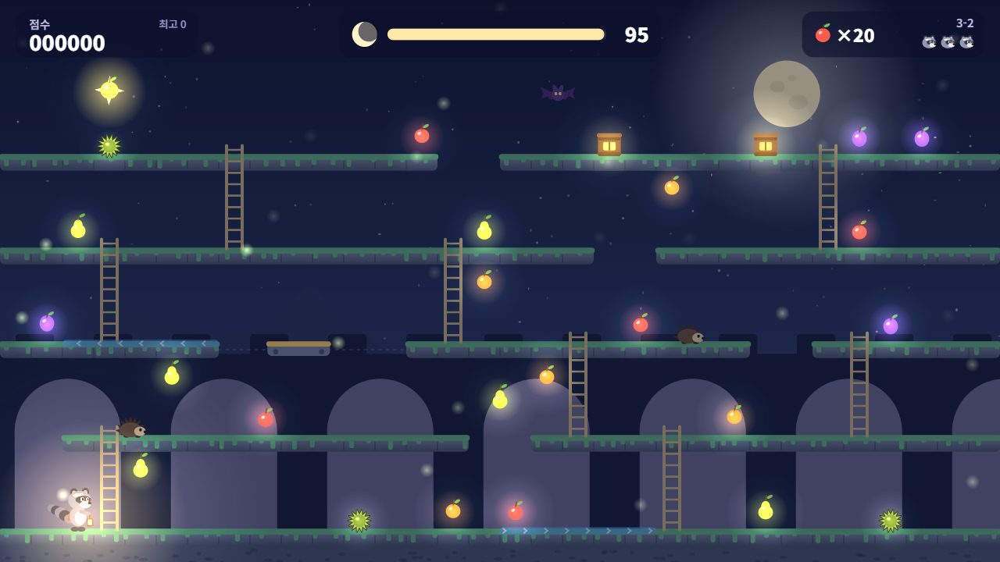
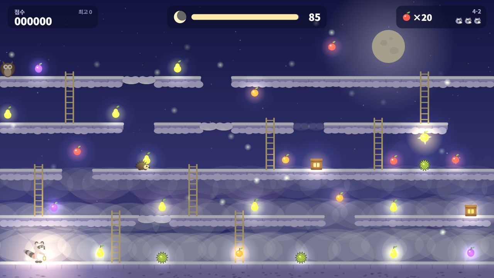

<div align="center">

<a href="https://jihunyangai.github.io/raccoon/"></a>

<a href="https://jihunyangai.github.io/raccoon/"></a>

**설치 없이 바로 시작 · PC · 휴대폰 · 태블릿 · 게임패드**

`1 PLAYER` &nbsp;·&nbsp; `4 WORLDS` &nbsp;·&nbsp; `24 STAGES` &nbsp;·&nbsp; `4 BONUS` &nbsp;·&nbsp; `TOP 10`

</div>

---

## 🌙 STORY

밤에만 열매가 빛나는 과수원 마을.
등불을 든 너구리 **루미**에게 주어진 시간은 달이 질 때까지입니다.

> **MISSION** &nbsp; 달 게이지가 바닥나기 전에 빛나는 열매를 모두 거두세요.

<div align="center">
 
</div>

## 🕹️ HOW TO PLAY

| 동작 | ⌨️ 키보드 | 🎮 게임패드 | 📱 터치 |
|:--|:--:|:--:|:--:|
| **이동** | `←` `→` / `A` `D` | 스틱 · 십자키 | 스틱 좌우 |
| **사다리** | `↑` `↓` / `W` `S` | 스틱 · 십자키 | 위아래로 밀고 손 떼기 |
| **점프** | `Space` / `Z` | `A` | 점프 버튼 |
| **발판 아래로** | `↓` + 점프 | `↓` + `A` | 아래로 밀고 점프 |
| **일시정지** | `Esc` / `P` | `Start` | ⏸ 버튼 |

### 📱 MOBILE MODE



- 조작판은 게임 화면 **바깥**에 있어서 캐릭터를 가리지 않습니다.
- 사다리에 다가가면 머리 위에 **노란 화살표**가 뜹니다. 한 번 밀고 손을 떼면 끝까지 자동으로 올라갑니다.
- **왼손잡이 모드**: `설정 > 터치 조작판`에서 스틱과 점프 자리를 바꿉니다.

## 🗺️ WORLD MAP

| WORLD 1 · 사과 언덕 | WORLD 2 · 덩굴 온실 |
|:--:|:--:|
|  |  |
| 나무 발판과 사다리로 몸풀기 | 흔들리는 덩굴, 부서지는 발판 |
| **WORLD 3 · 물레방아 골짜기** | **WORLD 4 · 달맞이 꼭대기** |
|  |  |
| 움직이는 발판, 밀어내는 물줄기 | 돌풍, 사라지는 구름 발판 |

월드마다 6스테이지, 스테이지마다 다른 배경. 월드를 끝내면 **보너스 스테이지**가 열립니다.
24스테이지를 모두 깨면 더 빨라진 **2회차**가 시작됩니다.

## 👾 DANGER!

공격 수단은 없습니다. **피하고, 넘고, 더 좋은 길을 찾으세요.**

| 위험 | 움직임 | 공략 |
|:--|:--|:--|
| 🌰 **밤송이** | 바닥에 고정 | 점프로 넘기 |
| 🦔 **고슴도치** | 발판 위를 순찰 | 넘거나 다른 층으로 돌아가기 |
| 🦇 **박쥐** | 정해진 곡선으로 비행 | 타이밍 맞춰 통과 |
| 🦉 **올빼미** | 같은 층에 있으면 돌진 | 층을 바꿔 시야에서 벗어나기 |
| 🔥 **도깨비불** | 상자에서 나와 잠시 추적 | 사다리로 따돌리기 |
| 🕳️ **추락** | 두 층 이상 떨어지면 아웃 | 사다리를 믿으세요 |

## 🏆 SCORE ATTACK

| 획득 | 점수 |
|:--|--:|
| 🍎 열매 | `100` × 콤보 |
| ✨ 황금 열매 | `1,000` × 콤보 |
| 🏮 등불 상자 보너스 | `500` |
| 🌙 남은 시간 1초 | `20` |
| ❤️ **1UP** | `20,000`점마다 목숨 +1 |

- **COMBO**: 2초 안에 다음 열매를 먹으면 배수가 올라갑니다. 최대 **×8**.
- **RANK**: 남은 시간, 최대 콤보, 무피격으로 **S · A · B · C** 등급을 받습니다.
- **등불 상자**: 점수일까, 시간 +10초일까, 도깨비불일까. 열어 봐야 압니다.

## 🎲 GAME MODES

| 모드 | 내용 |
|:--|:--|
| ▶️ **시작하기** | 목숨 3개로 1-1부터 달리는 정규 모드 |
| 🗂️ **스테이지 선택** | 깨 둔 스테이지에서 다시 도전 |
| ⏱️ **타임어택** | 가장 빠른 기록에 도전. 실수 1번에 5초 추가 |
| 🥇 **점수판** | 이름 3글자를 남기는 TOP 10 (이 기기에 저장) |
| 📖 **열매 도감** | 황금 열매를 모아 24칸 채우기 |

키 변경, 음량, 화면 흔들림, 색맹 모드, 전체 화면은 `설정`에 있습니다.

<details>
<summary><b>🔧 DEVELOPER MODE</b> (눌러서 열기)</summary>

<br>

```bash
npm install
npm run dev     # 개발 서버
npm test        # 테스트
npm run build   # 배포용 빌드
```

| 부품 | 사용 기술 |
|:--|:--|
| 언어 · 빌드 | TypeScript, Vite |
| 그래픽 | Canvas 2D, 이미지 파일 없이 코드로 그린 벡터 아트 |
| 사운드 | Web Audio로 실시간 합성한 칩튠과 브라스 징글 |
| 스테이지 | 시드 기반 절차 생성 |
| 테스트 | Vitest, 전 스테이지를 깨 보는 자동 플레이 봇 |
| 런타임 의존성 | 없음 |

기획서: [`poppoko.md`](poppoko.md)

</details>

---

<div align="center">

80년대 오락실 사다리 액션에 바치는 오마주.
캐릭터, 그래픽, 스테이지, 음악은 모두 새로 만들었습니다.

**GAME OVER?** &nbsp; <a href="https://jihunyangai.github.io/raccoon/"><b>CONTINUE ▶</b></a>

</div>
